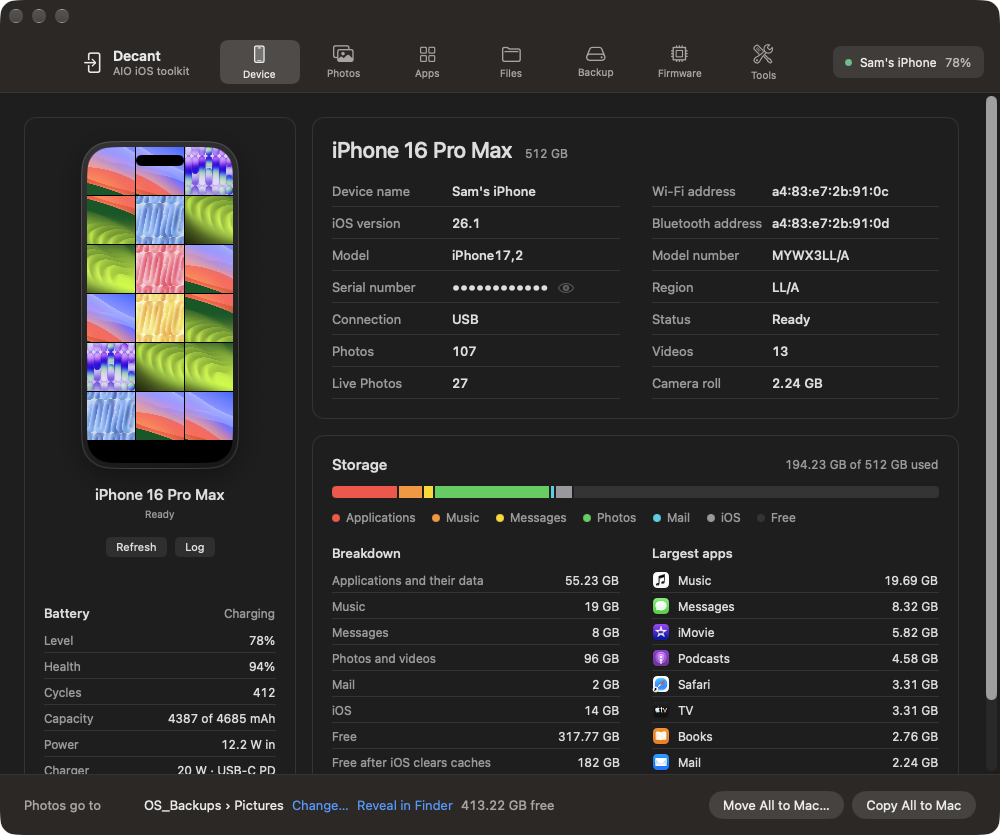
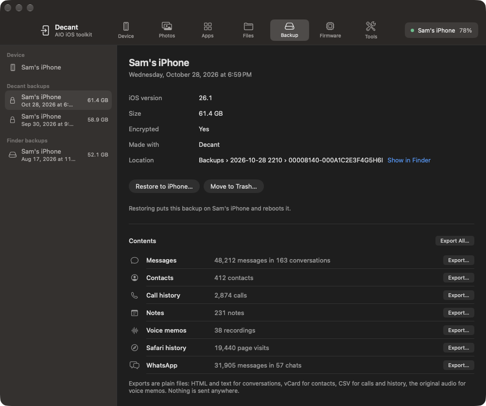
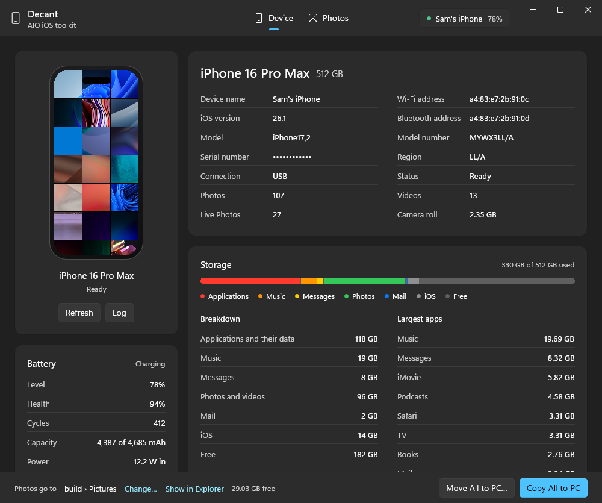
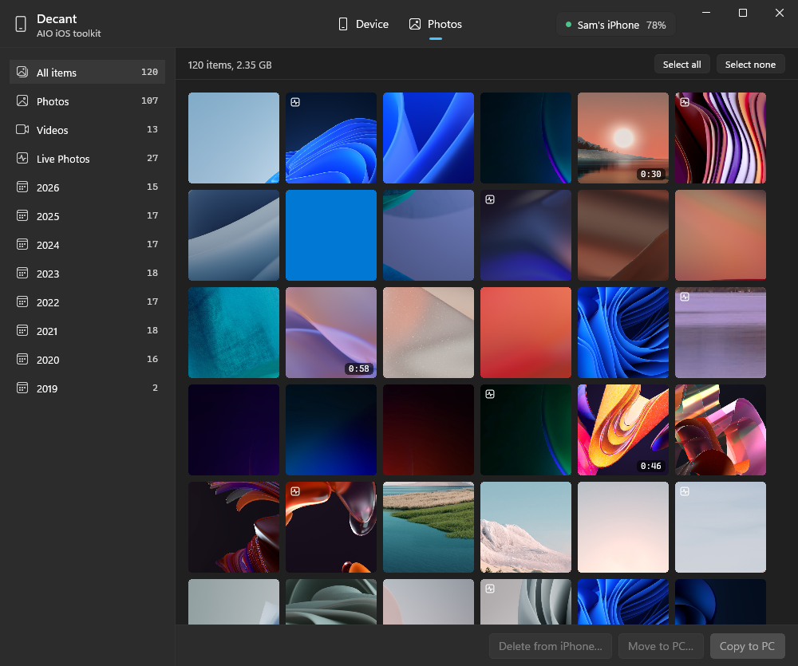

# Decant

**An iPhone toolkit for the Mac.** Plug in an iPhone and Decant shows what it is, moves its photos onto any
drive, backs it up, reads what is inside a backup, saves SHSH blobs, manages apps, files and ringtones, and
keeps an eye on the battery. Everything happens over the cable (or Wi-Fi, once you allow it); nothing is
uploaded anywhere and there is no account.

Apple Silicon Macs, macOS 15 or later. Native SwiftUI. The device tools it talks through
([libimobiledevice](https://libimobiledevice.org)) ship inside the app.



## Install

1. Download `Decant-<version>.dmg` from the [latest release](../../releases/latest).
2. Open it and drag **Decant** to Applications.
3. The first time, right-click Decant and choose **Open** (the app is not notarized).
4. Connect the iPhone with a cable, unlock it, and tap **Trust** on the phone if it asks.

That is all. Decant finds the phone on its own.

## What each tab does

| Tab | What you get |
|---|---|
| **Device** | The phone as it is: model, iOS version, serial (hidden until you click the eye), battery level, health, cycle count, charging power, and storage broken down the same way the iPhone's own Settings shows it, with the biggest apps. |
| **Photos** | The camera roll with thumbnails, filters by year and format, a viewer, and **Copy to Mac** or **Move to Mac**. Every file is checked against the phone before anything is deleted. With iCloud Photos on, deletes go through the Mac's Photos library so iCloud removes them everywhere. |
| **Apps** | Installed apps with real icons, app and data sizes, developer and App Store date. Sort by size, name or date added. Uninstall, or install a signed `.ipa` by drag and drop. |
| **Files** | Browse the phone's Media folder (books, downloads, recordings) and the documents of any app that shares files. Upload, download, delete. **Ringtones** lives here too: turn any song, voice memo or video into a tone (pick the start point, 30 or 40 seconds), and it appears in Settings → Sounds & Haptics. |
| **Backup** | Full backups to any folder, over USB or over Wi-Fi. Turn backup encryption on or off and change its password. Select any backup (Decant, Finder or iTunes) and read what it holds: messages, contacts, call history, notes, voice memos, Safari history and WhatsApp chats, each exportable as plain files. Encrypted backups open with their password. Restore, with two confirmations. |
| **Firmware** | SHSH blobs saved automatically for every iOS version Apple is still signing, with the standard generator, locked read-only so they can never be overwritten. Which versions are signed now, IPSW downloads, update or restore to a signed version, future restore with a saved blob. |
| **Tools** | Restart, shut down, recovery mode, rename, identifiers, device report, unpair, crash reports, live system log, screenshot, battery with a history chart that fills in as the phone connects, and diagnostics: charging watts, the phone's own self-tests. |



## Things worth knowing

- **Blobs are never replaced.** Once a blob is saved for a version, Decant will not ask Apple again and will not
  overwrite the file, even if you press Save Blobs Now. The day Apple stops signing a version, the blob you
  have is the one you keep.
- **Backups over Wi-Fi.** In the Backup tab turn on *Wi-Fi backups* once while the cable is in. After that,
  Decant backs the phone up when it is on the same network, cable or not. Restores still need the cable.
- **Reading a backup** never changes it. Exports are HTML and text for conversations, vCard for contacts, CSV
  for calls and history, the original audio for voice memos. The backup password is used in memory and is not
  saved.
- **Storage numbers** are counted the way iPhone Settings counts them (apps, music, messages, photos, mail,
  iOS). System Data cannot be read over USB, so the total runs a little under Settings.
- **Screenshot** of the phone needs Developer Mode on iOS 17 and later (Settings → Privacy & Security).
- **Finder backups** are listed when Decant has Full Disk Access (System Settings → Privacy & Security).

## Where things go

Nothing is tied to a particular drive. Photos default to your Pictures folder, backups to
`Documents/Decant/Backups`, blobs and firmware to `Documents/Decant`. Every one has a **Change…** button.

## Build from source

```sh
./build.sh install      # needs Xcode; installs /Applications/Decant.app
./release.sh 1.0.0      # bundles the device tools and makes dist/Decant-1.0.0.dmg
```

`DECANT_DEMO=1` launches the app with a sample iPhone for screenshots. Design rules for contributors are in
[DESIGN.md](DESIGN.md); what is planned next in [ROADMAP.md](ROADMAP.md).

## Windows

Decant for Windows is a native WinUI 3 app with the same layout and the same engine rules as the Mac version. It
runs on Windows 11 (ARM64 and x64) and covers the Device and Photos tabs for now: the phone as it is, battery
and storage, and copying or moving the camera roll to any folder with the same byte-count check before a delete.

| Mac | Windows |
|---|---|
|  |  |
|  |  |

It talks to the phone through the libimobiledevice tools and library, which need Apple's USB driver from the
**Apple Devices** app (or iTunes). The source and build script are in [windows/](windows/README.md); it is built
in a Windows 11 ARM virtual machine with `dotnet build`, no Visual Studio needed. No installer yet: unzip and run
`Decant.exe`.

## Licence

MIT for Decant itself. The bundled tools keep their own licences, listed in the app's third-party notices.
